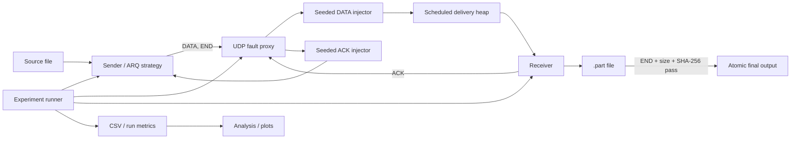
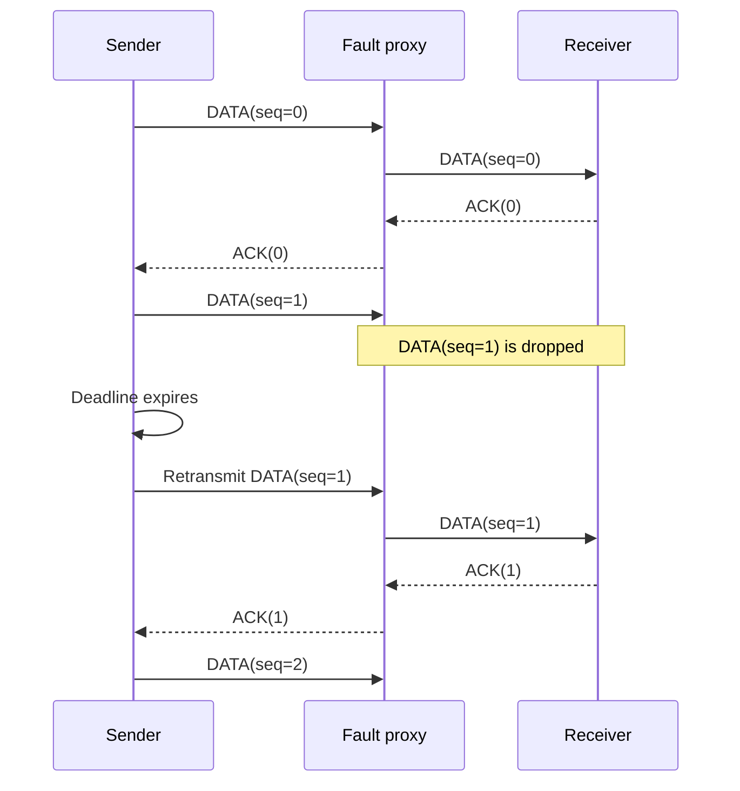
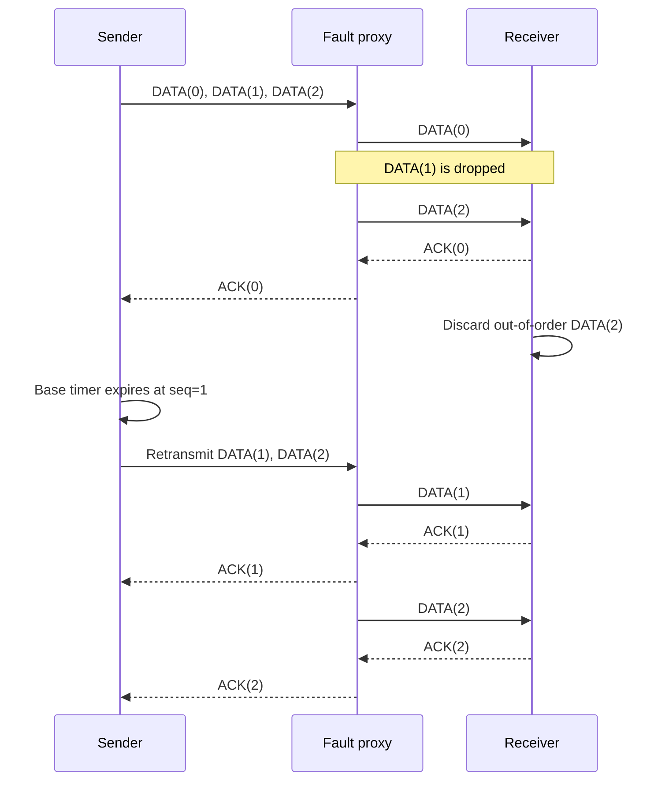
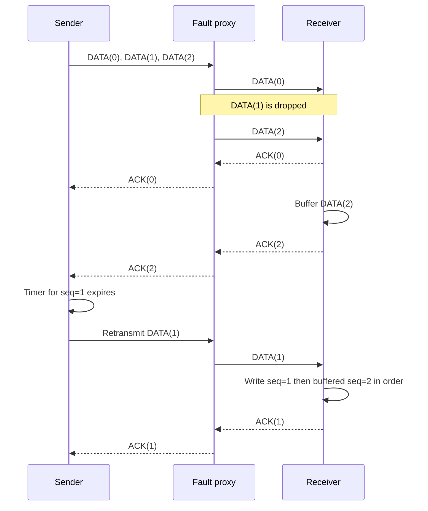

# Protocol and Architecture Diagrams

These diagrams describe the implemented experimental protocol. The sequence diagrams show a representative lost DATA packet and recovery; they are explanatory traces, not a claim about a measured benchmark run.

## 1. Packet format

```text
Offset      0              4       5               7                   11
            |--------------|-------|---------------|-------------------|------>
Field       sequence       type    payload_length  CRC32               payload
Width       4 bytes        1 byte  2 bytes         4 bytes             N bytes
            unsigned u32   u8      unsigned u16    unsigned u32        bytes

+----------------------+--------+----------------+--------------------+-------------+
| sequence (4 bytes)   | type   | length (2 B)   | CRC32 (4 bytes)    | payload (N) |
+----------------------+--------+----------------+--------------------+-------------+
|<----------------------------- fixed 11-byte header ---------------->|<-- data -->|
```

All fields are big-endian. Packet types are DATA=0, ACK=1, END=2. The CRC input is sequence + type + length + payload; the CRC field is not included in its own checksum.

## 2. Process architecture



## 3. Stop-and-Wait — DATA loss and timeout recovery



## 4. Go-Back-N — lost packet and suffix retransmission



## 5. Selective Repeat — buffer out-of-order data and recover one packet



## 6. Diagram interpretation

- Go-Back-N uses a cumulative ACK and discards out-of-order DATA; a gap can cause retransmission of the outstanding suffix.
- Selective Repeat ACKs valid in-window packets individually and buffers them until the missing earlier sequence arrives.
- Stop-and-Wait has only one in-flight DATA packet, so there is no multi-packet receive reordering within its sender window.
- The proxy's scheduled queue implements controlled fault injection; it is not a physical router or bandwidth-limited network.
